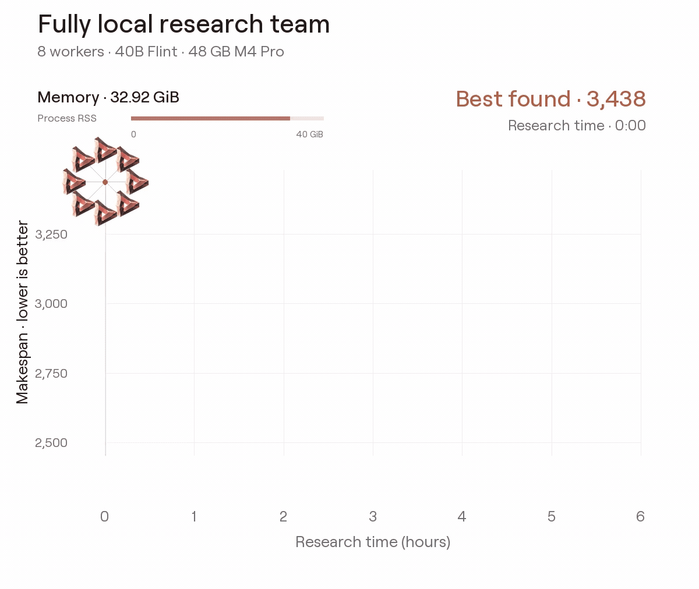

# Local Autoresearch

Let [Flint](https://recursive.com/updates/introducing-recursive-flint), a local language model from [Recursive](https://recursive.com/), improve a small program one experiment at a time. A runner tests each change and keeps the improvements. These geometry, scheduling and machine learning experiments ran entirely on my MacBook.

<p align="center">
  
</p>

[Try it](#try-it) · [Explore the experiments](#circle-packing) · [Run eight workers](#eight-workers) · [Add your own task](docs/add-a-task.md)

## Try it

On macOS, install [uv](https://docs.astral.sh/uv/getting-started/installation/), then check a starter solver and open a completed experiment. This works without Flint:

```sh
git clone https://github.com/conglu1997/local-autoresearch.git
cd local-autoresearch
uv sync --frozen --python 3.12
uv run python -m tasks check circle
open examples/2026-10-20-jobshop/report.html
```

The check should print `circle: valid baseline`. The report shows the schedules, scores and Flint's original responses.

To have Flint propose new changes, follow the [local server setup](docs/running.md#install-and-start-flint), then try four attempts:

```sh
uv run python research.py --task circle --run runs/circle-demo --experiments 4 --max-tokens 16384
uv run python report.py runs/circle-demo
```

Open `runs/circle-demo/report.html` to see your results. Each candidate gets 15 CPU seconds and 25 wall seconds; model generation takes additional time.

[Running, resuming and saving experiments](docs/running.md) · [All tasks](tasks/README.md) · [Add a task](docs/add-a-task.md)

## Circle packing

<p align="center">
  
</p>

Fit 26 circles inside a unit square without overlaps, maximizing the sum of their radii. The solver chooses both positions and sizes: moving one circle can make room for another. The baseline places equal circles on a grid.

Across 128 attempts, the mean sum of radii rose from **2.166667 to 2.629408**, a **21.4% increase** over the grid. This run averaged three trials: the picture shows one packing, while the curve shows the mean score.

[Complete run, animation and evaluation details](examples/2026-10-20-final/README.md)

## Factory scheduling

<p align="center">
  
</p>

Forty jobs share twenty machines. Each job has twenty operations that must happen in order, and each machine can do only one operation at a time. The solver orders all 800 operations to finish the work sooner. Speeding up one job can leave another waiting.

Across 100 attempts, finishing time fell from **3,438 to 2,545**, a **26.0% reduction** from a baseline that cycles through jobs in order.

[Complete run and machine timelines](examples/2026-10-20-jobshop/README.md) · [Task and run command](tasks/jobshop)

## Machine learning: bike rental demand

<p align="center">
  
</p>

Predict hourly bike rentals from calendar and observed weather in the public UCI Bike Sharing dataset. Flint experiments with ML features, model settings and small ensembles, starting from a time trend plus boosted residuals. Models train on 2011 and are scored on January–June 2012; July–December stays held out until the search ends.

Across 100 attempts, validation error (RMSLE) fell from **0.535904 to 0.370806**, a **30.81% reduction**. The frozen baseline and selected program were each refit unchanged and tested once on the held-out period: **0.395280 → 0.359408 RMSLE**, a **9.08% reduction**.

[Complete run and predictions](examples/2026-10-21-bike/README.md) · [Task, data attribution and run command](tasks/bike)

Each example includes every attempt, including failures.

## Eight workers

<p align="center">
  <a href="docs/eight-workers.md"></a>
</p>

Run eight workers around one local Flint model with llama.cpp. Each worker starts from the best program so far, tries one of four directions (refine, change approach, simplify or question an assumption) and shares any improvement as soon as it is tested.

In six-hour runs on a 48 GB M4 Pro, eight workers completed 2.0–2.5× as many valid experiments as a single worker running the same loop and finished with a better score in 5 of 6 pairs.

[Set up eight workers](docs/eight-workers.md) · [Results](docs/eight-worker-results.md)

## Add a task

Start with [a small change to an existing solver](docs/add-a-task.md#tweak-a-baseline), or [copy a task](docs/add-a-task.md#make-a-new-task) for your own problem. The runner discovers new tasks automatically. Templates cover depot placement, routes, job assignment and binary sequences.

## Develop

The two top-level scripts are the main entry points:

```text
research.py   Run a search with Flint
report.py     Turn a saved run into an HTML report
tasks/        Problem inputs, baselines, scoring and prompts
runner/       Model client, eight-worker scheduling and sandboxed evaluation
tools/        Export, verify and rebuild figures
examples/     The three completed experiments
docs/         Setup and task-writing guides
tests/        Checks for the runner and tasks
```

To change a solver, start with its baseline, such as [the circle solver](tasks/circle/baseline.py). See [resource limits](docs/running.md#start-and-inspect-a-search) for how candidates run.

Run the tests and style checks after changing code:

```sh
uv run pytest -q
uv run ruff check .
uv run ruff format --check .
```

To rebuild the README gallery from saved measurements, install `ffmpeg` and run:

```sh
uv run python -m tools.render_gallery
```

This reads the saved runs and doesn't call the model. The bike charts show the first three model hours; add `--bike-hours 6` to show the whole run, or see [rendering a new bike run](docs/running.md#render-a-new-bike-run) to use your own. [Images for sharing](docs/images/social).

`report.py` rebuilds each run's HTML report and plots. The example READMEs include the commands for the [circle animation](examples/2026-10-20-final#animation) and [detailed scheduling figure](examples/2026-10-20-jobshop#timelines-and-progress).

## Acknowledgments

These demos use Recursive's Flint to bring automated experimentation onto a MacBook, drawing on ideas from [Recursive's automated research work](https://recursive.com/updates/first-steps-toward-automated-ai-research). The experiment loop builds on work including Andrej Karpathy's [autoresearch](https://github.com/karpathy/autoresearch) and my earlier work with collaborators on [The AI Scientist](https://sakana.ai/ai-scientist/). It also draws inspiration from [Evolution through Large Models (ELM)](https://arxiv.org/abs/2206.08896), Google DeepMind's [FunSearch](https://deepmind.google/blog/funsearch-making-new-discoveries-in-mathematical-sciences-using-large-language-models/) and [AlphaEvolve](https://deepmind.google/blog/alphaevolve-a-gemini-powered-coding-agent-for-designing-advanced-algorithms/) on evolving programs, and studies of [research ideation](https://arxiv.org/abs/2409.04109) and [the ideation–execution gap](https://arxiv.org/abs/2506.20803). [AlphaFold](https://deepmind.google/science/alphafold/) is a broader inspiration for AI in science.

## Other models

Flint is the default. To use another local or remote model, set `--base-url` and `--model`, plus `--api-key-env` if authentication is required. See the [connection details](docs/running.md#another-model).

## License

Code, documentation and original visualizations are [MIT licensed](LICENSE). The UCI Bike Sharing data retains its [CC BY 4.0 license and attribution](tasks/bike/README.md#data). This license does not cover the separately distributed Flint model or runtime.

## Star history

<a href="https://www.star-history.com/?repos=conglu1997%2Flocal-autoresearch&amp;type=date">
  <picture>
    <source media="(prefers-color-scheme: dark)" srcset="https://api.star-history.com/svg?repos=conglu1997/local-autoresearch&amp;type=Date&amp;theme=dark" />
    <source media="(prefers-color-scheme: light)" srcset="https://api.star-history.com/svg?repos=conglu1997/local-autoresearch&amp;type=Date" />
    
  </picture>
</a>
