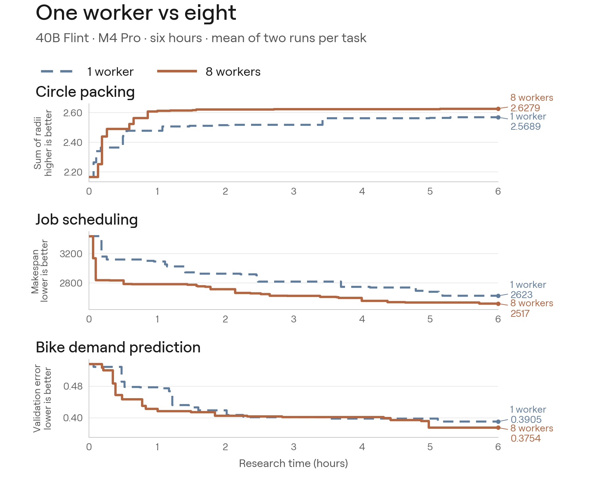

# Eight-worker results

I compared eight workers with a single worker running the same loop on a one-slot server (`--workers 1`). Both ran on 48 GB M4 Pro Macs on 23–24 October 2026. Each task had two pairs of six-hour runs on the same machine, swapping which configuration ran first.

  

| Task | One worker | Eight workers | Valid experiments per hour, eight vs one |
| --- | ---: | ---: | --- |
| Circle packing, sum of radii ↑ | 2.5689 | 2.6279 | 2.43× and 2.15× |
| Scheduling, makespan ↓ | 2623 | 2517 | 2.49× and 2.36× |
| Bike prediction, validation RMSLE ↓ | 0.3905 | 0.3754 | 2.04× and 2.27× |

Scores are the mean final result of the two runs. Eight workers finished ahead in 5 of the 6 pairs: both circle packing and scheduling pairs, and one of the two bike pairs.

The gain comes from running more experiments in the same time, not from better individual attempts. Compared at the same number of completed experiments, one worker was ahead on scheduling and bike. Two pairs per task is a small study, so treat these numbers as indicative.

I haven't isolated which parts of the recipe matter. Small single-run comparisons of sharing the best program and of rotating directions were inconclusive. On bike, sharing without the directions did slightly better.

The gallery runs in the main README are separate one-worker runs with attempt budgets, so their scores are not directly comparable with these.
