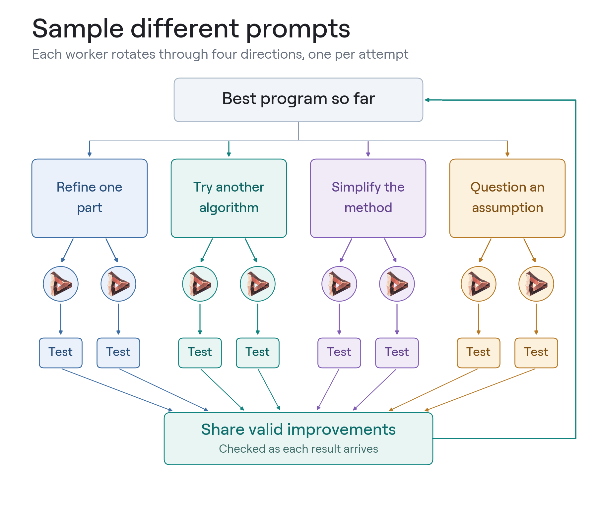

# Eight workers

Run eight research workers around one local Flint model. llama.cpp serves the model with eight parallel slots. Each worker asks for a change, tests it and shares any improvement with the others. Tasks, scoring and reports are the same as in the [one-worker loop](running.md).

<p align="center">
  
</p>

## Requirements

- An Apple Silicon Mac with at least 48 GB of unified memory. The runs here used a 48 GB M4 Pro.
- At least 30 GB of free disk space. Setup downloads a 26 GB model and builds llama.cpp.
- Python 3.12, [uv](https://docs.astral.sh/uv/getting-started/installation/), CMake and the Xcode command-line tools.

## Set up and run

```sh
uv sync --frozen --python 3.12
uv run python -m tools.llama_cpp setup --directory runs/flint-runtime
uv run python -m tools.llama_cpp run --directory runs/flint-runtime \
  --task circle --run runs/circle-team --hours 2
uv run python report.py runs/circle-team
open runs/circle-team/report.html
```

Setup builds a pinned version of llama.cpp and downloads the pinned [Flint GGUF](https://huggingface.co/RecursiveSI/flint-int4-gguf), checking both against SHA-256 hashes. If setup is interrupted, run it again: it resumes the download and reuses a finished build. If you already have `flint-int4-q4_1.gguf`, copy it into `runs/flint-runtime` first to skip the download.

`run` starts llama.cpp, waits for the model to load, runs the workers for `--hours` and then shuts everything down. Use a new `--run` directory each time. Replace `circle` with `jobshop`, `bike` or [another task](../tasks/README.md). Keep the Mac otherwise idle while it runs.

To check a finished run without executing its programs:

```sh
uv run python -m tools.verify_parallel runs/circle-team
```

## How it works

Every request contains the best program so far, the worker's own recent results and one of four directions:

1. Refine the current method with one concrete improvement.
2. Try a different algorithm or representation.
3. Simplify the method so more useful work fits in the time limit.
4. Identify a limiting assumption and test a different choice.

Workers start spread evenly across the four directions and move to the next one on each attempt; `--replicate` shifts the starting points. `--workers` changes the team size and the number of server slots. Workers never wait for each other. When a candidate beats the best program, the next request from any worker starts from it. Candidates have the same 15 CPU seconds and 25 wall seconds as in the one-worker loop.

The server gives each worker 65,536 tokens of context with a Q8 KV cache. Sampling uses temperature 1, top-p 0.95 and top-k 20, with up to 32,768 output tokens per response. The launcher stops the run if llama.cpp exits, if it and the workers use more than 42 GiB of memory, or if swap grows by more than 4 GiB. Server logs and memory samples are saved next to the run, in `runs/circle-team.runtime`.

## Use your own server

`research.py --hours` runs the same team against any OpenAI-compatible server that handles eight requests at once:

```sh
uv run python research.py --task circle --run runs/circle-team --hours 2 \
  --base-url http://127.0.0.1:8080/v1 --model flint
```

For llama.cpp, use a release with Flint support, as described on the [model card](https://huggingface.co/RecursiveSI/flint-int4-gguf).

See the [results](eight-worker-results.md) for how eight workers compared with one.
